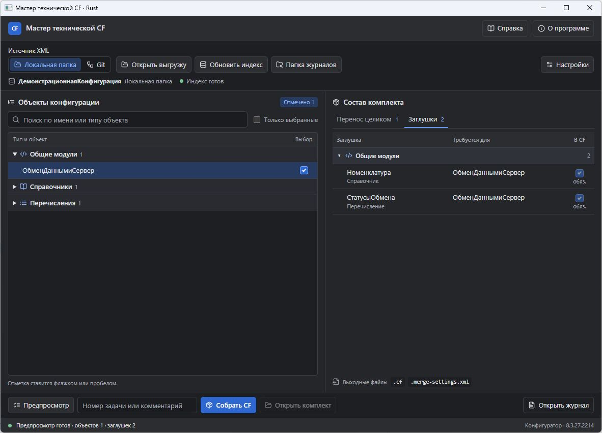

# CF Wizard

Мастер технической **CF** для 1С. Откройте XML-выгрузку из локальной папки или ветки **Gitea / GitHub**, отметьте объекты, проверьте зависимости и соберите `.cf` с настройками объединения.

Текущая версия — **0.8.0-rust.2**. Движок и оболочка работают на Rust. Переносимый EXE для Windows x64 занимает около **7,7 МиБ**.

## Скачать и начать работу

- [Скачать EXE 0.8.0-rust.2](https://github.com/ziva08081992/cf-wizard/releases/download/v0.8/CF-Wizard-Rust-0.8.0-rust.2.exe)
- [Руководство пользователя со скриншотами](docs/user-guide.md)
- [Скачать иллюстрированную инструкцию Word](docs/CF-Wizard-0.8.0-rust.2-User-Guide-RU-Illustrated.docx?raw=1)
- [Что изменилось в 0.8.0-rust.2](docs/releases/v0.8.0-rust.2.md)
- [Опубликованный выпуск и SHA256SUMS.txt](https://github.com/ziva08081992/cf-wizard/releases/tag/v0.8)

Выпуск на GitHub называется **CF Wizard 0.8.0** и имеет тег **`v0.8`**; версия приложенного EXE — **`0.8.0-rust.2`**. Иллюстрированный Word в этом репозитории обновлён отдельно от первоначальной текстовой инструкции в Assets выпуска. Опубликованные EXE и контрольные суммы не заменялись.

### Быстрый старт

1. Скачайте EXE и запустите его. Нужны **Windows x64**, **Microsoft Edge WebView2 Runtime** и установленная платформа **1С x64** для сборки CF. Установщик мастера не требуется.
2. В **Настройках** выберите папки результата, журналов и индексов SQLite. Режим **Авто** использует Конфигуратор **8.3.27.2214**; другую установленную платформу можно указать вручную.
3. Выберите **Локальная папка** и откройте выгрузку / `Configuration.xml` либо выберите **Git** и настройте подключение. Для Git подготовьте индекс кнопкой **Создать индекс**.
4. Отметьте объекты флажками. Нажмите **Предпросмотр** и проверьте дерево заглушек. На этом шаге временный XML-комплект и CF не создаются.
5. Нажмите **Собрать CF**. После сборки и обратной проверки нажмите **Открыть комплект**: в папке результата будут только `.cf` и `.merge-settings.xml`.

Мастер предназначен для **основной конфигурации**. Расширения **CFE не поддерживаются**. Техническая CF нужна для сравнения и выборочного объединения; результат объединения проверяют на тестовой копии базы.

## Возможности

- Дерево объектов с русскими названиями типов, поиск и фильтр **Только выбранные**. Переносятся объекты целиком, включая их формы и модули.
- Источники по стратегиям: локальная XML-выгрузка, API Gitea и API GitHub. Git-клон не требуется; нужные файлы загружаются выборочно и закрепляются за SHA открытой ревизии.
- Отбор объектов по номеру задачи в сообщениях коммитов: последние 90 дней, произвольное число дней или вся история. Поиск отбирает объекты; для сборки используется их содержимое из текущей открытой ревизии ветки.
- Постоянный индекс SQLite. При неизменных XML используется сохранённый индекс, включая новую Git SHA с тем же составом XML. При изменениях появляется **Обновить индекс**; обновление изменившихся записей выполняется по кнопке.
- Предпросмотр зависимостей без подготовки сборочного комплекта. Дерево заглушек показывает, кому нужна зависимость; обязательные ссылки защищены от исключения.
- Сборка через пакетный Конфигуратор или `ibcmd`, с обратной выгрузкой для проверки комплекта. В rust.2 добавлен лёгкий кэш заглушек внутри одного расчёта с проверкой входов.
- Настройки и пути сохраняются. Необязательная задача или комментарий задаёт имя папки результата; пустое поле даёт текущую дату и время.
- Просмотр журналов внутри программы, отдельные записи об ошибках, сжатые `.jsonl.gz`. Персональный токен можно хранить в Диспетчере учётных данных Windows.

## Документация и исходники

| Для кого | Материал |
| --- | --- |
| Пользователь | [Пошаговое руководство](docs/user-guide.md), [Word со скриншотами](docs/CF-Wizard-0.8.0-rust.2-User-Guide-RU-Illustrated.docx?raw=1) |
| Разработчик | [Сборка и проверки](BUILD.md), [Rust workspace](tools/cf-wizard-rust/README.md) |
| Ревьюер | [Изменения rust.2 и границы проверок](docs/releases/v0.8.0-rust.2.md), [анализ расчёта зависимостей](docs/benchmarks/2026-11-13-rust-dependency-cpu-analysis.md) |

Рабочая версия находится в `tools/cf-wizard-rust`: слои `domain`, `application`, `infrastructure`, `desktop`. Файлы в `tools/1c-delivery` и архив `CF-Wizard-0.7.1-sources.zip` относятся к прежней Python-версии.

## Благодарность

Алгоритм технической конфигурации перенесён на Rust из проекта [alonehobo/1c-partial-cf](https://github.com/alonehobo/1c-partial-cf). Большое спасибо **alonehobo** за исходный скрипт `partial_cf.py`. В текущем EXE Python-скрипт не запускается. Закреплённая upstream-версия и сведения о совместимости приведены в [описании Rust-версии](tools/cf-wizard-rust/README.md).
