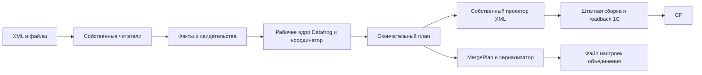

# Собственные читатели и формирователь: вариант следующего этапа

Статус: исследование и предложение, **не выполненная замена в 0.8.5**. Пользователь отменил вариант «только CF»: сохраняем `.cf` и `.merge-settings.xml`, XML-подготовку, UUID, ресурсы и обратную проверку.

## Что заменять

Новое ядро уже вычисляет замыкание. Следующая работа лежит на его границах:

| Часть | Собственная реализация | Что остаётся контрактом |
| --- | --- | --- |
| Читатели XML, типов, путей форм и поддерживаемых литералов | Структурированные факты с категорией ссылки, исходным файлом/узлом и причиной | Форматы 1С, namespace/QName, сильные и слабые ссылки, существующие UUID |
| Проектор заглушки | Применение окончательного плана к исходным XML-узлам и файлам | Полные выбранные объекты сохраняются; у заглушки остаются запланированные обязательные части |
| Генератор настроек объединения | Типизированный MergePlan и отдельный XML-сериализатор | Защита заглушек и прежних несвязанных данных, перенос выбранных объектов, точные links |

## Предлагаемая последовательность

**Сначала читатели.** Отделить чтение свойств, вложенных членов, типов, форм и ресурсов от решений о сохранении. Результат — факты и адресные свидетельства, передаваемые уже работающему ядру. Объявления Form/Template не смешивать с индексом полей. Типизированная metadata-ссылка и произвольный текст имеют разную обязательность. Динамический BSL и неподдерживаемые конструкции нельзя выдавать за полностью распознанные зависимости.

Начать с XML metadata/type reader; затем отдельно заменить form paths и ограниченные BSL/query readers. Библиотечный XML-parser использовать можно: собственная реализация не требует написания парсера XML с нуля. Смысловая политика, обработка namespaces и контракт результата при этом принадлежат проекту.

**Затем проектор.** Ввести собственные операции над диапазонами/узлами: сохранить, удалить, заменить служебное значение, перенести файл. Он получает окончательный ProjectionPlan и не добавляет зависимости, не выбирает минимальные поля и не решает, какой регистратор нужен. Полные XML/BSL/бинарные файлы копируются с проверкой содержимого; ZIP проверяется по содержимому, а не только по имени или размеру.

**После него настройки объединения.** Сначала определить независимый контракт MergePlan по ролям full/stub/service и целям защиты, затем написать сериализатор. Сохранить текущий комплект и проверить выборочное объединение в новых отдельно разрешённых receivers. Текущий незакрытый случай добавления StandardAttributes регистру нельзя использовать как уже пройденный эталон.

## Кэш и совместимость

Кэш должен связывать факты с содержимым XML **и версией семантики читателя**. Одинаковый Git SHA/XML-хеш не доказывает актуальность фактов, если правила их извлечения изменились. Не менять схему/профиль SQLite до проверки совместимости; миграция выполняется явно по кнопке. Если новая семантика несовместима, одноразовое перечитывание затронутого класса XML может оказаться необходимым даже при неизменных файлах. Обычные последующие обновления остаются инкрементальными.

Исходные UUID не пересоздавать. Совместимость служебных UUID тоже проверить отдельно: текущий детерминированный генератор происходит из прототипа и не является стандартным UUIDv5. Незаметная замена алгоритма даст новые идентификаторы при тех же объектах.

## Как доказывать замену

- Зафиксировать независимые ожидаемые факты и конечный состав для полного/пустого/циклического графа, поздних требований, форм, составных типов и регистратора. Старые snapshots использовать как контроль совместимости с явно описанными исправлениями.
- Проверять неизменность полных объектов, обязательные элементы и UUID заглушек, ресурсы, сценарии исключений и отсутствие записей индекса в preview.
- После каждого слоя выполнить сборку/readback и selective merge на отдельно согласованных новых базах. Статические тесты не заменяют платформенную и бизнес-приёмку.
- Сопоставить время, чтения и память на одинаковом составе. Само устранение перенесённого кода не гарантирует ускорения.
- Перед изменением уведомлений проверить фактически оставшийся код и источники каждого компонента. Благодарность историческому прототипу можно сохранить; перевод языка или переименование функций не доказывают независимость и не закрывают вопросы прав.

Предпочтительный путь — замена по этим трём границам. Он позволяет сохранять проверяемый рабочий комплект после каждого шага. Одновременная перепись всех слоёв затруднит поиск причины отличий CF и проверку миграции кэша.
