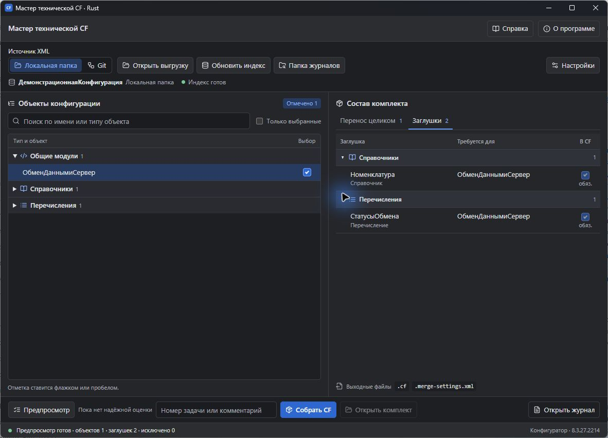

# CF Wizard 0.9.0

Мастер технической CF для Windows x64. Комплект включает файл технической конфигурации и настройки выборочного объединения.

## Что изменилось

- Рабочий бюджет памяти задаётся в настройках. Мастер регулирует размер кэша и восстанавливает разобранные XML по мере необходимости. При ручном бюджете от 40% доступной сейчас памяти появляется предупреждение.
- Предпросмотр показывает ориентир по времени после двух сопоставимых успешных запусков. История сохраняется на компьютере.
- Общие XML-имена, адреса, пути, контрольные суммы и исходный текст занимают меньше памяти. Сохранённые индексы SQLite V3 остаются совместимыми.
- Сравнение XML при обратной проверке выполняется быстрее. На контрольной выборке ERP УХ полная сборка сократилась с 21,4–22,0 до 19,2–20,0 с. Правила проверки полных объектов и заглушек сохранены.

## Обновление

Запустите `CF-Wizard-0.9.0.exe` на Windows x64 с Microsoft Edge WebView2 Runtime. Для сборки нужна установленная 1С x64. Режим **Авто** выбирает Конфигуратор 8.3.27.2214. [Руководство с текущими скриншотами](../user-guide.md).

## Проверки и ограничения

В контрольных прогонах совпал состав зависимостей и SHA-256 настроек объединения. CF прошли обратную проверку в Конфигураторе 8.3.27.2214. Результат выборочного объединения проверяйте на тестовой копии целевой базы.

Замеры бюджета мастера, сравнение до и после ускорения, размер локальной выгрузки и наблюдавшийся объём загрузки Gitea собраны в [отчёте по тестам 0.9.0](../reports/cf-wizard-0.9.0-benchmarks.md).
