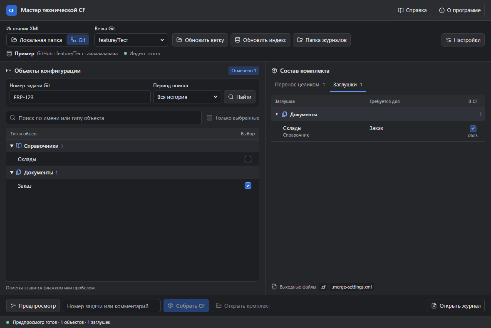
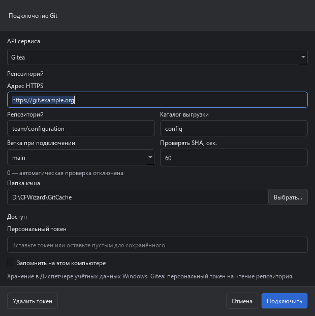
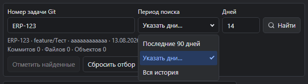

# CF Wizard Руководство пользователя

Версия 0.7.2

Мастер помогает разработчику 1С выбрать объекты основной конфигурации, проверить связанные объекты и получить техническую CF с настройками объединения. Источником служит полная Designer XML-выгрузка в локальной папке либо выбранная ветка Gitea или GitHub. Результат предназначен для сравнения и выборочного объединения с конфигурацией получателя.

## Быстрый запуск

1. Скачайте `CF-Wizard-0.7.2-windows-x64.exe` со [страницы выпуска](https://github.com/ziva08081992/cf-wizard/releases/tag/v0.7.2) и запустите его. Установщик и отдельный Python не нужны.
2. Откройте «Настройки», выберите папки результата, журналов и индекса, проверьте способ сборки и установленную платформу 1С.
3. Выберите «Локальная папка» или «Git», откройте источник и при необходимости создайте индекс.
4. Отметьте объекты, нажмите «Предпросмотр» и проверьте вкладку «Заглушки».
5. Нажмите «Собрать CF». Кнопка «Открыть комплект» откроет папку результата.

## Подготовка и настройки

Нужны Windows x64, доступ к исходникам и установленная платформа 1С с подходящим инструментом сборки. Мастер работает с основной конфигурацией и создаёт CF. Расширения CFE в этот сценарий не входят.

| Настройка | Что указать |
| --- | --- |
| Папка результата | Каталог для готовых комплектов с CF и настройками объединения |
| Папка журналов | Удобный каталог для журналов операций и подпапки «Ошибки» |
| Папка индекса зависимостей | Каталог для постоянных SQLite; у разных источников и веток отдельные файлы |
| Способ сборки | «Авто», «Конфигуратор» либо «ibcmd» |
| Платформа 1С | В ручном режиме путь к соответствующему `1cv8.exe` или `ibcmd.exe` из установленной платформы |

«Авто» использует пакетный Конфигуратор платформы 8.3.27.2214. Если нужная платформа не найдена, выберите ручной способ и укажите исполняемый файл совместимой установленной версии. Для ibcmd используйте файл из папки bin платформы с необходимыми библиотеками и компонентом автономного сервера.

Пути сохраняются между запусками. Диалог выбора начинает с каталога соответствующей строки; для пустой строки используется последний выбранный каталог.

## Локальная XML выгрузка

1. Выберите источник «Локальная папка».
2. Кнопкой «Папка» укажите корень полной XML-выгрузки либо кнопкой «Configuration.xml» выберите её основной файл.
3. Нажмите «Открыть выгрузку». Сохранённый источник также загружается при запуске мастера.

Можно использовать доступную сетевую папку. Оставляйте её содержимое неизменным между предпросмотром и сборкой; после обновления исходников повторите предпросмотр.

## Подключение к Git

1. Переключите источник на «Git» и откройте подключение через «Настройки».
2. Выберите API сервиса, заполните параметры репозитория и введите персональный токен с правом чтения.
3. Нажмите «Подключить», выберите ветку и нажмите «Открыть ветку» либо «Обновить ветку».

| Поле подключения | Пример и смысл |
| --- | --- |
| API сервиса | Gitea для своего сервера либо GitHub для github.com |
| Адрес HTTPS | `https://git.example.org` для Gitea или `https://github.com` для GitHub |
| Репозиторий | Владелец и имя, например `team/configuration`, без полного URL |
| Каталог выгрузки | Путь внутри репозитория, например `config` |
| Ветка при подключении | Например `main` или `release` |
| Папка кэша | Постоянный локальный каталог загруженных файлов |
| Проверять SHA сек | Период проверки изменений ветки; 0 отключает автоматический опрос |

Мастер использует API чтения и управляемый кэш файлов; локальный Git-клон не нужен. При сообщении об изменении ветки обновите её явно. Открытая SHA показывает, какое состояние исходников используется.

Для приватного GitHub-репозитория токен должен иметь доступ к нему и разрешение Contents на чтение. Если поставить «Запомнить на этом компьютере», токен сохраняется в Диспетчере учётных данных Windows. Без флажка он используется в текущем сеансе. Кнопка «Удалить токен» удаляет сохранённый токен выбранного подключения. Токены Gitea и GitHub разделены.

## Индекс зависимостей

После открытия источника нажмите «Создать индекс» или «Обновить индекс». SQLite хранит факты о типах, полях и документах-регистраторах. В журнале видны длительность и количество добавленных, изменённых, удалённых и переиспользованных записей.

Файлы SQLite сохраняются между запусками. В версии 0.7.2 пригодность Git-индекса привязана к открытой SHA: после перехода к другой ревизии мастер может снова потребовать обновление. Скачанные данные и факты неизменных объектов переиспользуются, но полная сверка XML пока остаётся. Новая схема готовности по составу XML подготовлена отдельно как план и в этот выпуск не включена.

В Git-режиме подготовьте индекс до предпросмотра. При переключении источника мастер предложит выбрать папку индекса; несколько отдельных баз можно хранить в одной папке. В локальном режиме обновляйте индекс после актуализации XML.

## Поиск объектов по номеру задачи Git

Поиск доступен после открытия ветки. Он читает сообщения коммитов, сопоставляет изменённые пути с объектами текущей ревизии и применяет отбор к дереву.

1. Введите ключ, например `ERP-123`, в поле «Номер задачи Git». Регистр не важен; `ERP-1234` не считается совпадением с `ERP-123`.
2. Выберите период: «Последние 90 дней», «Указать дни…» или «Вся история».
3. Для своего периода введите положительное целое число суток, например 14, и нажмите «Найти». Границы рассчитываются в UTC на момент запуска и выводятся в результате.
4. Проверьте счётчики и дерево. «Отметить найденные» добавит результат к уже отмеченным объектам. «Сбросить отбор» вернёт полное дерево, сохранив отметки.

Неверный или чрезмерно большой период отклоняется до обращения к серверу. Для дат ранее 1970 года используйте «Вся история»: диапазон дат Git API ограничен 1970–2099 годами. Поиск можно отменить; отмена или ошибка сохраняет предыдущий отбор.

Состав подбирается по истории, а содержимое объектов берётся из открытой SHA. Это не восстановление исторического состояния задачи: более поздние изменения выбранного объекта тоже войдут в комплект.

Поле «Номер задачи Git» служит только поиску коммитов. Отдельное поле «Номер задачи или комментарий» необязательно и принимает произвольный текст для имени папки комплекта, например дату или внутренний номер.

## Отметки и предпросмотр

1. Найдите объекты по имени или русскому названию типа. Раскройте нужную группу дерева.
2. Поставьте флажки в колонке «Выбор» либо нажмите пробел на выделенном объекте. Щелчок по названию выделяет строку. «Только выбранные» помогает проверить отмеченный состав.
3. Нажмите «Предпросмотр». На вкладке «Перенос целиком» показаны выбранные объекты; на вкладке «Заглушки» раскройте группы и проверьте колонку «Требуется для».

Заглушка — минимальное описание связанного объекта, необходимое для технического комплекта. Доступный флажок «В CF» позволяет исключить необязательную заглушку, найденную только в комментариях BSL. Обязательные заглушки отключить нельзя. Повторяющиеся отображения одной заглушки имеют общую отметку.

Предпросмотр определяет зависимости и состав, но ещё не собирает CF. При Git-чтении нужные исходники могут появляться в кэше; журнал операции тоже сохраняется. Изменение выбора или источников требует нового предпросмотра.

## Сборка и результат

1. Проверьте папку результата, способ сборки и необязательный комментарий.
2. Нажмите «Собрать CF». Мастер использует план предпросмотра, готовит XML-комплект и настройки объединения, запускает выбранный инструмент 1С и проверяет результат обратной выгрузкой.
3. После успешного завершения нажмите «Открыть комплект».

В папке комплекта остаются файл `.cf` и `.merge-settings.xml`. Если комментарий пуст, имя папки формируется по текущим дате и времени; если имя занято, добавляется числовой суффикс. Недопустимые для Windows символы комментария заменяются. Временный XML-комплект очищается после сборки или ошибки; журналы остаются в своей папке.

Для переноса откройте CF в режиме сравнения и объединения Конфигуратора и используйте настройки объединения. Техническая целостность файла не подтверждает корректность изменений в базе получателя: состав и работу результата проверяют отдельно на тестовой копии.

## Журналы и ошибки

«Открыть журнал» показывает последнюю операцию в отдельном окне мастера. Текст можно выделить и скопировать. «Папка журналов» открывает каталог всех журналов. Журналы доступны после индексации, предпросмотра и сборки.

| Ситуация | Что проверить |
| --- | --- |
| Кнопка предпросмотра недоступна | Источник открыт, объекты отмечены, для Git подготовлен индекс |
| Нет доступа к Git | API, адрес, владелец и репозиторий, ветка, токен чтения и доступность сервера |
| По задаче ничего не найдено | Точный ключ в сообщениях, выбранная ветка и период; затем расширьте период |
| Нужен индекс после смены SHA | Нажмите «Обновить индекс»; в этой версии это ожидаемая проверка готовности |
| Ошибка сборки | Путь к платформе, способ сборки и этап остановки в журнале |
| Программа закрылась | Подпапка «Ошибки» в папке журналов и версия из «О программе» |

Если выбранная папка журналов недоступна, отчёт об ошибке сохраняется в `%LOCALAPPDATA%\CF-Wizard\logs\Ошибки`. Для разбора проблемы подготовьте версию программы, способ сборки, источник, последний шаг и журнал операции; токен прикладывать не нужно.

## Справка и используемый сборщик

Кнопка «Справка» и F1 открывают встроенную инструкцию. «О программе» показывает версию и ссылки на компоненты.

Для подготовки технического комплекта используется скрипт partial_cf.py из [репозитория alonehobo](https://github.com/alonehobo/1c-partial-cf). Спасибо автору за сборщик. Исходники оболочки и выпуски доступны в [репозитории CF Wizard](https://github.com/ziva08081992/cf-wizard).
