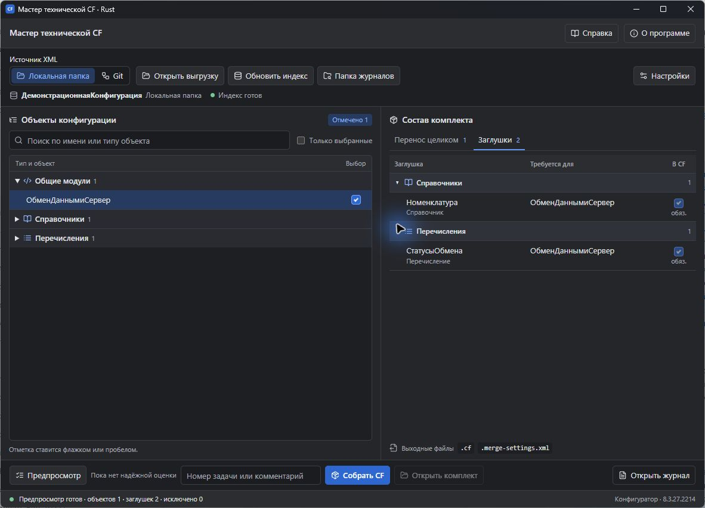
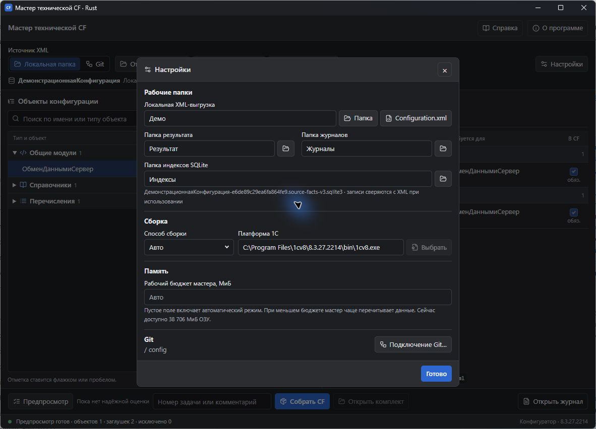
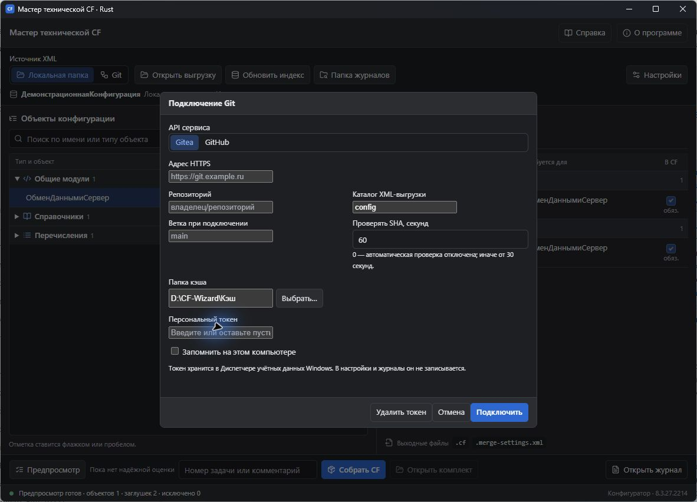

# Мастер технической CF

Руководство пользователя · CF Wizard 0.9.0

## Для чего нужен мастер

CF Wizard создаёт небольшую техническую конфигурацию из выбранных объектов XML-выгрузки 1С и необходимых заглушек. Источником служит локальная папка или каталог выгрузки в ветке Gitea / GitHub. Результат — `.cf` и `.merge-settings.xml` для сравнения и выборочного объединения.

Скриншоты сделаны в CF Wizard 0.9.0 на демонстрационной конфигурации. Пример подключения содержит условный адрес и пустое поле токена.

Запускайте мастер на Windows x64 с Microsoft Edge WebView2 Runtime. Для сборки CF нужна установленная платформа 1С x64.

Расход памяти зависит от выбранных объектов и их зависимостей. В разделе **Настройки → Память** виден доступный сейчас объём ОЗУ. Там же можно задать рабочий бюджет в МиБ. При бюджете от 40% доступной памяти мастер показывает предупреждение и сохраняет значение. Пустое поле включает автоматический режим.

Мастер рассчитан на основную конфигурацию. Перед выборочным объединением сохраните резервную копию и проверьте результат на тестовой базе.

<!-- pagebreak -->

## Первый запуск и настройки

Запустите `CF-Wizard-0.9.0.exe` и откройте **Настройки** справа вверху.

| Поле | Что указать |
| --- | --- |
| Локальная XML-выгрузка | Папку иерархической выгрузки или её Configuration.xml. |
| Папка результата | Куда помещать готовые комплекты CF. |
| Папка журналов | Где хранить историю операций и сведения об ошибках. |
| Папка индексов SQLite | Постоянную папку для баз зависимостей. |
| Рабочий бюджет мастера, МиБ | Укажите числовой бюджет или оставьте поле пустым для автоматического режима. |
| Способ сборки и платформа | «Авто» использует Конфигуратор 8.3.27.2214. Для другого варианта выберите Конфигуратор или ibcmd и нужный EXE. |

Нажмите **Готово**. Мастер сохранит пути и при следующем запуске откроет последнюю локальную выгрузку. Диалог выбора начинается с текущего пути или последней выбранной папки. При приближении к заданному бюджету мастер освобождает разобранные XML и при необходимости перечитывает их из того же снимка.

<!-- pagebreak -->

## Локальная выгрузка и постоянный индекс

### Как открыть и выбрать объекты

1. Выберите источник **Локальная папка**.
2. Нажмите **Открыть выгрузку**. Путь можно задать в настройках кнопками **Папка** или **Configuration.xml**. Нужна полная иерархическая XML-выгрузка основной конфигурации, а не файл CF, DT или XML расширения.
3. Дождитесь появления названия конфигурации и дерева объектов.
4. Раскройте нужный тип и отметьте объекты флажками. Нажатие на строку меняет фокус; отметку меняет флажок или пробел.
5. Для поиска введите часть имени или русский тип объекта. **Только выбранные** оставляет в дереве отмеченные объекты; скрытие строки фильтром не снимает отметку.

Объект переносится целиком: его модули, формы и другие вложенные файлы не выбираются по отдельности. Список **Перенос целиком** справа показывает отмеченные объекты. Состав заглушек появляется после **Предпросмотра**. После двух сопоставимых успешных запусков возле этой команды отображается ориентировочный диапазон в секундах. История хранится локально и учитывает набор объектов, источник, индекс и рабочий бюджет.

### Как работает SQLite

Нажмите **Создать индекс**, чтобы сохранить зависимости в выбранной папке. Первое построение читает XML-описания. Последующие обновления пересчитывают изменившиеся записи; индекс сохраняется между запусками программы. В локальном режиме предпросмотр возможен и без готового индекса, но повторные обращения к XML могут занимать больше времени.

При смене выгрузки или источника мастер предлагает выбрать папку индексов. Для разных конфигураций, веток и источников используются отдельные файлы SQLite. Папка индексов может быть общей. При переносе готового индекса сохраняйте исходное имя файла.

Старый совместимый индекс импортируется в отдельный файл с окончанием `.rust.sqlite3`; исходная база не перезаписывается. Файловая проверка актуальности сохраняется и при работе через SQLite.

Индекс SQLite хранит разобранные метаданные. Git-кэш хранит полученные файлы. Это разные данные: храните обе папки постоянно, чтобы повторные запуски использовали уже подготовленные материалы.

### Время работы при ручном бюджете памяти

В таблице приведены замеры CF Wizard 0.9.0 на локальной выгрузке ERP УХ с готовым SQLite V3. Исходные файлы и ресурсы выгрузки занимали 10,81 ГБ.

| Бюджет мастера | Предпросмотр | Пик частной памяти мастера при предпросмотре | Сборка CF с обратной проверкой |
| --- | ---: | ---: | ---: |
| 1024 МиБ | 15,1–15,3 с | 862–1096 МиБ | 20,4 с |
| 2048 МиБ | 15,0–15,2 с | 1335–1338 МиБ | 19,9 с |
| 4096 МиБ | 15,2–15,8 с | 2113–2164 МиБ | 20,5 с |

Для каждого бюджета выполнено по два предпросмотра 10 объектов с 936 заглушками. Сборку замеряли отдельно от предпросмотра на выборке из 10 объектов с 790 заглушками, с момента нажатия **Собрать CF** до завершения обратной проверки в Конфигураторе 8.3.27.2214.

Бюджет регулирует размер кэша и порций. На отдельных шагах расход может временно превысить заданное значение. Для Windows, WebView2 и Конфигуратора требуется собственная память. Размер выборки, сравнение до и после ускорения и условия прогона приведены в [отчёте по замерам](reports/cf-wizard-0.9.0-benchmarks.md).

<!-- pagebreak -->

## Подключение к Git

Откройте **Настройки → Подключение Git…**. Мастер читает ветку через API Gitea или GitHub.

1. Выберите **Gitea** или **GitHub**. Для GitHub укажите `https://github.com`. Для Gitea введите HTTPS-адрес своего сервера.
2. Укажите `владелец/репозиторий`, каталог XML-выгрузки, например `config`, и ветку. В каталоге должен находиться `Configuration.xml`.
3. Укажите постоянную **Папку кэша**. При первом подключении она может быть пустой. Чтобы отключить опрос SHA, укажите **0**. Рабочий интервал составляет **30–86400 секунд**.
4. Введите персональный токен с доступом на чтение нужного репозитория и нажмите **Подключить**. Для приватного GitHub подойдёт токен с правом **Contents: Read-only** на выбранный репозиторий.

Флажок **Запомнить на этом компьютере** сохраняет токен в Диспетчере учётных данных Windows. Без него токен используется в текущем сеансе. Токен не записывается в JSON настроек и журналы. Перенос EXE на другой компьютер не переносит сохранённый токен.

<!-- pagebreak -->

## Обновление ветки и поиск коммитов

### Как заполняется Git-кэш

Для первой индексации большой конфигурации рекомендуем открыть готовую XML-выгрузку в режиме **Локальная папка** и создать индекс там. Предпросмотр и сборку можно выполнить из той же выгрузки. Если нужен поиск по коммитам или работа напрямую с веткой, используйте готовый совместимый индекс Git для этой ветки.

1. Выберите источник **Git**, нужную ветку и нажмите **Открыть ветку**. Мастер получает `Configuration.xml` и опись файлов закреплённой ревизии. После открытия кнопка становится **Обновить ветку**.
2. Если подходящего SQLite ещё нет, нажмите **Создать индекс**. На пустом кэше мастер скачивает недостающие XML-описания, нужные для индекса. Полученные файлы сохраняются в Git-кэше, затем мастер разбирает XML и строит SQLite в папке индексов.
3. Дождитесь статуса **Индекс готов**. При предпросмотре и сборке мастер пополняет Git-кэш недостающими файлами выбранных объектов и зависимостей. На каждом этапе полученные файлы остаются в Git-кэше. [Пример объёма загрузки из Gitea](reports/cf-wizard-0.9.0-benchmarks.md#индексация-gitea).

### Как использовать сохранённый индекс Git

1. Поместите готовый файл `.source-facts-v3.sqlite3` в **Папку индексов SQLite** с исходным именем. Используйте тот же сервер Git, репозиторий, каталог выгрузки и ветку.
2. Откройте ветку. Мастер сверит индекс с манифестом XML. Если XML совпадают и формат индекса совместим, появится статус **Индекс готов**, даже если SHA коммита уже другая. В этом случае создайте предпросмотр сразу. Папка Git-кэша при первом открытии может быть пустой.
3. Если XML изменились, нажмите **Обновить индекс**. Мастер переиспользует пригодные записи и загрузит недостающие новые и изменённые XML. Сам опрос SHA индекс не перестраивает.

Открытая ревизия закреплена за SHA. Проверка по таймеру сообщает о новой версии ветки; чтобы перейти к ней, нажмите **Обновить ветку**. Если исходные материалы изменились после предпросмотра, выполните его заново.

### Как отобрать объекты по комментарию коммита

1. Введите **Комментарий коммита Git**, например `TASK-123` или `исправление обмена`. Ключ задачи должен совпасть целиком, поэтому поиск `TASK-123` пропустит `TASK-1234`. Прочий текст ищется как буквальный фрагмент без учёта регистра. Поле принимает до 256 байт UTF-8 без управляющих символов.
2. Выберите **Последние 90 дней**, **Указать дни…** или **Вся история**. Для произвольного периода задайте положительное целое число дней.
3. Нажмите **Найти**. Мастер читает сообщения коммитов выбранной ветки за период, получает пути изменённых файлов и сопоставляет их с объектами конфигурации. Продолжительный поиск можно отменить.
4. Проверьте отобранные объекты и нажмите **Отметить найденные**. Новые отметки добавляются к уже выбранным.
5. **Сбросить отбор** убирает ограничение по результату поиска. Проверьте флажки и список **Перенос целиком** перед сборкой.

Поиск выбирает объекты по истории изменений. Их содержимое для CF берётся из **текущей открытой ревизии ветки**, а не из старого найденного коммита. Если файл удалён или не сопоставлен с объектом, учитывайте сообщение поиска и проверяйте итоговый список.

Поле **Номер задачи или комментарий** внизу окна служит для имени папки результата. Оно не запускает поиск в Git.

<!-- pagebreak -->

## Предпросмотр и сборка

### Проверка зависимостей

Нажмите **Предпросмотр** после выбора объектов. Мастер рассчитывает зависимости и показывает дерево **Заглушки**, сгруппированное по типам объектов, которым они требуются. Колонка **Требуется для** объясняет причину включения. Этот шаг не создаёт временный XML-комплект, CF или настройки объединения; журнал операции сохраняется.

Обязательные заглушки отмечены и недоступны для снятия. Ссылки, найденные только в комментариях BSL, можно исключить доступным флажком. Перед исключением проверьте причину появления зависимости.

После изменения выбора снова запустите предпросмотр. Фильтр **Только выбранные** помогает просмотреть переносимые объекты.

### Создание комплекта

1. При необходимости заполните **Номер задачи или комментарий**. Допустимы число, дата или свободный текст, например `1235`, `13.11.2026` или `Исправление обмена`. Символы, недопустимые в имени папки Windows, заменяются. Если поле пустое, имя содержит текущие дату и время.
2. Проверьте папку результата и способ сборки. В режиме **Авто** используется Конфигуратор 8.3.27.2214. При ручном выборе `ibcmd.exe` он должен находиться в `bin` установленной соответствующей платформы вместе с её библиотеками.
3. Нажмите **Собрать CF**. Используется план предпросмотра; без исключений заглушки повторно не ищутся. Изменение исключений может потребовать проверки нового плана. Проверки актуальности исходных файлов сохраняются.
4. Дождитесь окончания. Мастер готовит временный XML-комплект, собирает CF в новых временных базах и сверяет результат обратной выгрузкой. Если исходники изменились, выполните новый предпросмотр.
5. Нажмите **Открыть комплект**. В созданной папке должны остаться только `.cf` и `.merge-settings.xml`.

Откройте CF в Конфигураторе для сравнения и выборочного объединения. Файл настроек помогает восстановить выбранный состав. Мастер проверяет целостность комплекта обратной выгрузкой. Совместимость и поведение результата объединения проверьте на тестовой копии целевой базы.

<!-- pagebreak -->

## Журналы и разбор ошибок

**Открыть журнал** внизу окна показывает последнюю операцию внутри программы. **Папка журналов** вверху открывает выбранный каталог со всей историей. Папка задаётся в настройках. Создание и обновление индекса, предпросмотр, подключение, сборка и ошибки протоколируются.

Журналы хранятся как сжатые JSON-lines (`.jsonl.gz`). Сведения об аварийных завершениях и ошибках находятся в подпапке **Ошибки**. Временные XML и базы удаляются после завершения операции; журналы, SQLite и Git-кэш сохраняются для следующих запусков. После аварии могут остаться материалы прерванной операции.

| Ситуация | Что сделать |
| --- | --- |
| Пустое дерево | Проверьте путь и наличие Configuration.xml; откройте выгрузку повторно. |
| «Нужно обновить» для Git | Обновите ветку и нажмите «Обновить индекс»; дождитесь готовности. |
| По задаче ничего не найдено | Проверьте ветку, текст задачи, период поиска и сообщения коммитов. |
| «Предпросмотр» недоступен | Отметьте объекты; для Git сначала подготовьте индекс. |
| Ошибка платформы или сборки | Проверьте выбранный EXE платформы и откройте журнал операции. |
| Программа закрылась | Посмотрите подпапку «Ошибки». Зафиксируйте версию мастера, источник, ревизию и действие перед завершением. |

Справка внутри программы открывается кнопкой **Справка** или **F1**. В окне **О программе** указаны версия, автор ZiVa и ссылки на репозиторий CF Wizard и исходный проект alonehobo.

## Обновление и контрольная сумма

Файлы для скачивания находятся в [выпусках CF Wizard](https://github.com/ziva08081992/cf-wizard/releases). Это руководство относится к `CF-Wizard-0.9.0.exe`. Для сверки выполните в PowerShell `Get-FileHash -Algorithm SHA256 -LiteralPath .\CF-Wizard-0.9.0.exe` и сравните результат с `SHA256SUMS.txt` из той же поставки.

Настройки сохраняются в `%LOCALAPPDATA%/CF-Wizard/paths.json`. При замене EXE мастер подхватывает сохранённые пути и настройки.

Алгоритм технической конфигурации перенесён из [alonehobo/1c-partial-cf](https://github.com/alonehobo/1c-partial-cf). Большое спасибо alonehobo за исходный скрипт. Во время работы Rust EXE Python-скрипт не запускается.

<!-- pagebreak -->

## Проверенная платформа и команды

Сборка и обратная проверка проверены на **1С 8.3.27.2214 для Windows x64** через Конфигуратор и `ibcmd`. Состав выгрузки влияет на результат проверки. Используйте журнал операции, если платформа отклоняет XML или обнаружено расхождение после обратной выгрузки.

В режиме **Авто** выбирается точно Конфигуратор 8.3.27.2214. Если он не установлен, автоматического перехода на другую версию нет. Вручную допускается выбрать другую установленную платформу x64, но её совместимость пока не подтверждена и требует отдельной проверки на вашей XML-выгрузке. 32-разрядные EXE отклоняются.

### Пакетный Конфигуратор

Мастер запускает выбранный **1cv8.exe** со следующими командами:

1. `CREATEINFOBASE` — создаёт новую временную файловую базу.
2. `DESIGNER /LoadConfigFromFiles` — загружает подготовленную XML-конфигурацию в эту базу.
3. `DESIGNER /DumpCfg` — создаёт техническую CF.
4. Второй `CREATEINFOBASE` — создаёт отдельную временную базу обратной проверки.
5. `DESIGNER /LoadCfg` — загружает полученную CF в проверочную базу.
6. `DESIGNER /DumpConfigToFiles` с `-Format Hierarchical` — выгружает XML для сверки.

Мастер передаёт путь базы через `/F`, отключает диалоги запуска служебными ключами и получает результаты через `/Out` и `/DumpResult`.

### Инструмент ibcmd

Мастер запускает **ibcmd.exe** из установленной платформы:

1. `infobase create` — создаёт временную базу и служебный каталог.
2. `config import` с `--out` — импортирует XML и получает файл CF.
3. `config export` с `--file` — выполняет обратную XML-выгрузку из полученной CF.

Это команды внешних процессов, а не методы BSL или COM. [Полные аргументы и проверки сборки](../BUILD.md#платформа-1с-и-команды-сборки) приведены в документации разработчика. Используются собственные временные базы; корректность объединения с целевой конфигурацией проверяет разработчик на тестовой копии.
